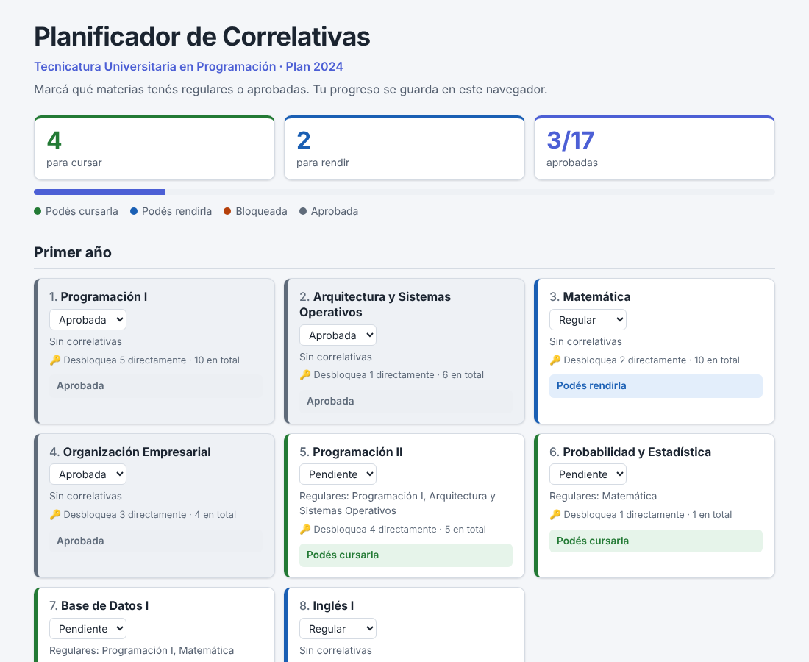

# Planificador de Correlativas

[](https://github.com/TTubi/planificador-correlativas/actions/workflows/tests.yml)

App web para estudiantes de la **Tecnicatura Universitaria en Programación (UTN, plan 2024)**. Marcás qué materias tenés regulares o aprobadas y te muestra qué podés cursar, qué podés rendir, qué está bloqueado y qué te falta para desbloquearlo.



## Qué hace

- **Plan por año** con las correlativas de cada materia.
- **Marcás tu estado** en cada materia: pendiente, regular o aprobada.
- **Te dice qué podés hacer:**
  - 🟩 Podés cursarla.
  - 🟦 Podés rendirla.
  - 🟧 Bloqueada, con la lista exacta de lo que falta. Por ejemplo: "Para cursar falta: Programación II (regular)".
- **Materias llave:** cuántas materias desbloquea cada una, directamente y en cadena. Por ejemplo, Programación I y Matemática desbloquean 10 de las 17.
- **Sin cuentas ni login:** tu progreso se guarda en tu navegador (`localStorage`). El servidor no guarda datos personales.

## Reglas de correlatividad

Según la Ordenanza N.º 2019/2023 del Consejo Superior de la UTN, cada materia tiene dos listas de correlativas:

- **Para cursar** una materia, sus correlativas `regulares` tienen que estar al menos regularizadas y sus correlativas `aprobadas`, aprobadas.
- **Para rendir** una materia, tiene que estar regularizada y todas sus correlativas (las dos listas) tienen que estar aprobadas.

El plan completo está en [`data/tup_plan2024.json`](data/tup_plan2024.json).

## Stack

| Parte | Tecnología |
|---|---|
| Backend | Python 3.13, FastAPI, Pydantic, Uvicorn |
| Base de datos | SQLite con SQL escrito a mano (módulo `sqlite3`, sin ORM) |
| Frontend | HTML, CSS y JavaScript sin frameworks |
| Tests | pytest y `TestClient` de FastAPI |
| CI | GitHub Actions (Windows y Linux) |

## Cómo correrlo

Necesitás Python 3.13 (o 3.10 o más nuevo).

**Windows (PowerShell):**

```powershell
git clone https://github.com/TTubi/planificador-correlativas.git
cd planificador-correlativas
python -m venv .venv
.venv\Scripts\Activate.ps1
pip install -r requirements.txt
python -m scripts.cargar_plan
uvicorn app.main:app --reload
```

**Linux o macOS:**

```bash
git clone https://github.com/TTubi/planificador-correlativas.git
cd planificador-correlativas
python3 -m venv .venv
source .venv/bin/activate
pip install -r requirements.txt
python -m scripts.cargar_plan
uvicorn app.main:app --reload
```

Después abrí <http://127.0.0.1:8000/>.

`python -m scripts.cargar_plan` genera la base `planificador.db` a partir del JSON del plan. Hay que correrlo la primera vez y cada vez que cambie el JSON.

### Tests

```bash
python -m pytest
```

Los tests no necesitan la base generada: los de la API arman una base temporal propia.

## API

La documentación interactiva está en <http://127.0.0.1:8000/docs>.

| Método | Ruta | Qué hace |
|---|---|---|
| `GET` | `/api/plan` | Materias del plan con su año y sus correlativas. |
| `GET` | `/api/llaves` | Qué materias desbloquea cada una, de la más llave a la menos. |
| `POST` | `/api/evaluacion` | Recibe el estado del alumno y devuelve qué puede cursar y rendir, y qué le falta. |
| `GET` | `/health` | Verifica que el servidor esté funcionando. |

Ejemplo:

```http
POST /api/evaluacion
Content-Type: application/json

{ "estados": { "1": "aprobada", "3": "regular" } }
```

Las materias que no aparecen se consideran pendientes. Una materia inexistente o un estado inválido devuelven `422`.

## Estructura

```
app/
├── main.py              # crea la app, registra los routers y sirve el frontend
├── routes/              # endpoints HTTP
├── schemas/             # modelos Pydantic: el contrato de la API
├── services/            # lógica pura: correlativas, materias llave, validación del plan
├── database/            # esquema SQLite y el único módulo con SQL
└── static/              # frontend: index.html, estilos.css, app.js
data/tup_plan2024.json   # fuente de verdad del plan de estudios
scripts/cargar_plan.py   # valida el plan y genera la base
tests/
```

## Decisiones de diseño

- **La lógica es pura.** `services/` recibe datos y devuelve resultados, sin leer la base, archivos ni HTTP. Así se testea rápido, y la misma función sirve para la API o para un script.
- **El JSON es la fuente de verdad.** La base SQLite es un archivo generado y no se versiona. Al cargarla, el plan se valida: referencias a materias inexistentes, nombres repetidos y correlativas circulares (con búsqueda en profundidad sobre el grafo de correlativas).
- **SQL a mano, en un solo módulo.** Sin ORM, para entender qué pasa con la base. Las restricciones (`CHECK`, `FOREIGN KEY`) repiten algunas validaciones de Python, así la base tampoco acepta datos sin sentido.
- **Las reglas viven en un solo lugar.** El frontend no recalcula correlativas: le pregunta a la API. Así no hay dos implementaciones que puedan diferir.
- **Sin datos personales en el servidor.** El progreso queda en el navegador del alumno.

## Próximos pasos

- Deploy con una demo online.

Fuera del alcance por ahora: login, cálculo de cuatrimestres restantes, equivalencias, Trabajo Final Integrador y otras carreras.

## Autor

Proyecto de portfolio de Agustín ([TTubi](https://github.com/TTubi)), estudiante de la Tecnicatura Universitaria en Programación en la UTN Facultad Regional Rosario.
